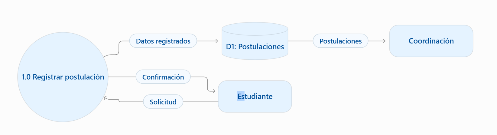
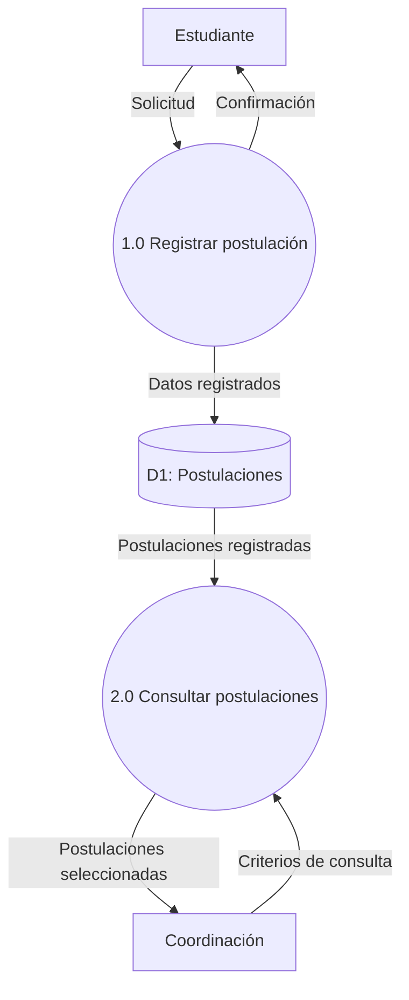

# Unidad 2. Modelado de Sistemas mediante Diagramas de Flujo de Datos (DFD)

## Contenidos del programa

- Conceptos de modelado estructurado.
- Componentes: procesos, flujos, almacenes y entidades externas.
- Niveles: contexto, nivel 1 y nivel 2.
- Ejercicios prácticos de modelado de procesos empresariales.

## Objetivo de aprendizaje

Construir DFD y comprobar el balance entre niveles.

## Trabajo de la unidad y evaluación

Corresponde a **E2**, según el [índice de ocho entregables](../../proyecto-integrador/entregables/README.md). Las fichas reúnen alcance, guía de elaboración, evidencias y comprobación previa. No se asignan tareas paralelas ni porcentajes internos.

## Herramienta principal y convenciones DFD

Mermaid es la herramienta principal para construir los DFD como código dentro de Markdown, con control de versiones Git y visualización en GitHub. diagrams.net y Lucidchart quedan como recursos complementarios.

Mermaid utiliza diagramas de flujo generales; la notación DFD deberá definirse explícitamente mediante convenciones de formas, nombres y conexiones. Para esta asignatura:

| Elemento DFD | Convención Mermaid | Nombre |
|---|---|---|
| Entidad externa | Rectángulo `E["Estudiante"]` | Actor o unidad externa al sistema |
| Proceso | Círculo `P(("1.0 Registrar postulación"))` | Identificador y verbo más objeto |
| Almacén | Cilindro `D[("D1: Postulaciones")]` | Identificador y conjunto de datos; convención visual del curso |
| Flujo de datos | Flecha etiquetada `-->\|Solicitud\|` | Sustantivo que identifica los datos transferidos |

Los flujos conectan entidades con procesos, procesos entre sí o procesos con almacenes. La lectura o escritura de un almacén siempre pasa por un proceso. No se usan flechas de secuencia como sustituto de datos; se comprueba el balance entre el contexto y las descomposiciones. Estas formas constituyen una adaptación docente explícita, no una notación DFD nativa de Mermaid.

## Ejemplo simplificado · Gestión de Pasantías

### Representación inicial del ejemplo

Ejemplo simplificado del sistema de gestión de pasantías. Mermaid utiliza diagramas de flujo generales; la notación DFD deberá definirse explícitamente mediante convenciones de formas, nombres y conexiones.

En la representación inicial hay una conexión directa entre D1 y Coordinación. El código siguiente muestra la versión que cumple las reglas DFD: la consulta pasa por un proceso.

### Código Mermaid y representación

En GitHub, utilizar la vista de código del archivo para consultar el bloque y la vista renderizada para ver el diagrama.

Este fragmento ilustra registro y consulta; no representa el contexto completo ni sustituye la descomposición a nivel 2 exigida en E2. Mantener los mismos identificadores y flujos en el diccionario de E3.

## Prácticas de ingeniería aplicadas

**SDD y verificación.** Comprobar en E2 el balance y la coherencia de los DFD. Que Mermaid renderice el código no demuestra que el modelo sea correcto. Consultar las [estrategias transversales](../../docs/enfoques-ingenieria.md). Estas prácticas forman parte de los entregables existentes.

## Recursos

- [Programa principal y presentación](../../programa/README.md).
- [Presentación general del programa y del proyecto](../../presentaciones/README.md).
- [Bibliografía y recursos del tema 2](../../recursos/bibliografia.md#tema-2).
- [Herramientas del entorno docente](../../recursos/herramientas.md).

[Unidades](../README.md) · [Inicio](../../README.md)
