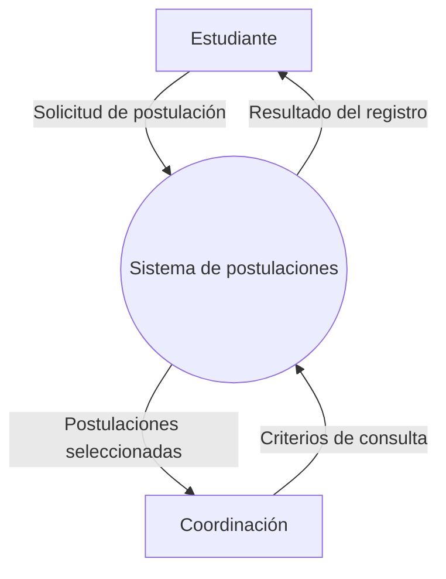
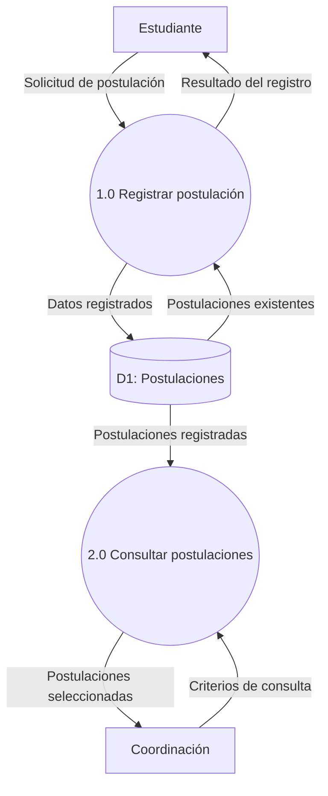
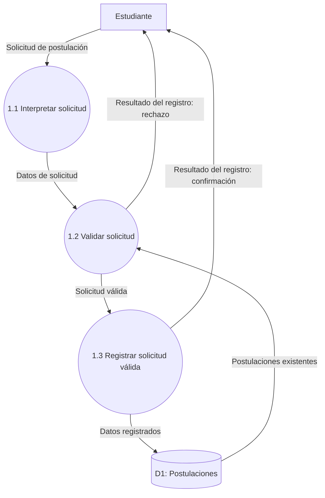

# Ejemplo · Contexto, nivel 1 y nivel 2

Caso hipotético y acotado al registro y consulta de postulaciones. No describe todo el proyecto de pasantías ni procedimientos oficiales. «Resultado» incluye confirmación o rechazo; los errores no se ocultan bajo una respuesta de éxito.

Para este fragmento se parte de un estudiante identificado y una oferta existente ya seleccionada. La verificación de esas referencias pertenece al sistema completo; aquí se modelan la estructura de la solicitud y la ausencia de duplicado.

## Contexto del fragmento

## Nivel 1

Los intercambios con Estudiante y Coordinación se conservan respecto del contexto. Las lecturas y escrituras de D1 son intercambios internos al sistema.

## Nivel 2 del proceso 1.0

La regla de no duplicar una postulación es hipotética en este ejemplo. El proceso 1.2 compara estudiante y oferta con las postulaciones existentes. En una implementación concurrente, esta revisión no sustituye una restricción de integridad en BD.

## Balance de la frontera de 1.0

| Intercambio del padre | Representación en nivel 2 |
|---|---|
| Entrada: solicitud del estudiante | Entrada a 1.1 |
| Entrada: postulaciones existentes de D1 | Entrada a 1.2 |
| Salida: datos registrados hacia D1 | Salida de 1.3 |
| Salida: resultado hacia el estudiante | Confirmación de 1.3 o rechazo de 1.2 |

El resultado se descompone en alternativas del mismo flujo; su estructura y dominio se describen en E3. La numeración de procesos no sustituye la explicación de sus reglas en E4.

[Apuntes](apuntes.md) · [E2](../../proyecto-integrador/entregables/e02.md) · [Unidad II](README.md)
