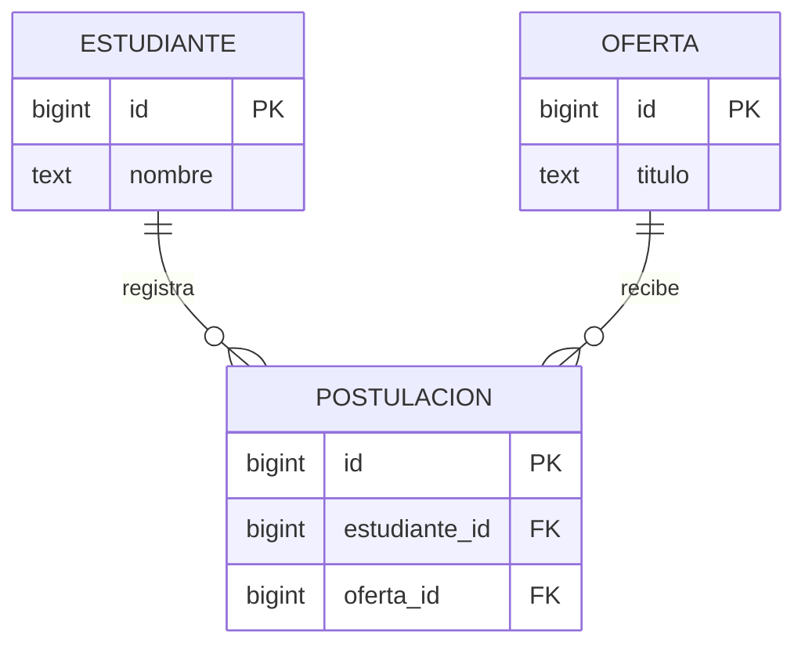

# Ejemplo · Estudiante, oferta y postulación

Caso hipotético, limitado a los datos necesarios para comprender claves y duplicados. No representa el esquema completo del proyecto de pasantías. Utilizar exclusivamente una BD local de prueba.

## Modelo ER del fragmento



Cada postulación requiere exactamente un estudiante y una oferta. Un estudiante o una oferta pueden existir sin postulaciones. La regla hipotética añade que cada par estudiante–oferta aparece a lo sumo una vez.

## Esquema SQL del ejemplo

```sql
BEGIN;
CREATE TEMP TABLE estudiante (
    id bigint PRIMARY KEY,
    nombre text NOT NULL
);
CREATE TEMP TABLE oferta (
    id bigint PRIMARY KEY,
    titulo text NOT NULL
);
CREATE TEMP TABLE postulacion (
    id bigint PRIMARY KEY,
    estudiante_id bigint NOT NULL REFERENCES estudiante(id),
    oferta_id bigint NOT NULL REFERENCES oferta(id),
    UNIQUE (estudiante_id, oferta_id)
);
INSERT INTO estudiante VALUES (1, 'Estudiante de prueba');
INSERT INTO oferta VALUES (10, 'Oferta de prueba');
INSERT INTO postulacion VALUES (100, 1, 10);
SELECT p.id, e.nombre, o.titulo
FROM postulacion p
JOIN estudiante e ON e.id = p.estudiante_id
JOIN oferta o ON o.id = p.oferta_id;
ROLLBACK;
```

Resultado esperado: una fila que relaciona la postulación 100 con el estudiante y la oferta del ejemplo. Las tablas temporales y la transacción evitan conservar cambios del ejercicio al terminar. Ejecutar el bloque en una sesión de prueba donde no existan tablas con esos nombres.

## Comprobación de la restricción

Para observar el rechazo de un duplicado, repetir el bloque y, antes del SELECT, intentar `INSERT INTO postulacion VALUES (101, 1, 10);`. Debe fallar por la restricción única. Después de ese error, ejecutar `ROLLBACK`; PostgreSQL no permite continuar una transacción abortada como si nada hubiera ocurrido.

## Justificación de diseño

En estudiante, `id` determina `nombre`; en oferta, `id` determina `titulo`. En postulación, `id` y el par `(estudiante_id, oferta_id)` son claves candidatas del caso. No se repiten nombre ni título dentro de postulación: se obtienen mediante referencias. Bajo estas dependencias declaradas, las relaciones satisfacen 3FN.

## Fragmento de diccionario BD

| Campo o restricción | Definición |
|---|---|
| postulacion.id | Identificador de fila, clave primaria |
| estudiante_id | Referencia obligatoria a estudiante.id |
| oferta_id | Referencia obligatoria a oferta.id |
| Par estudiante_id–oferta_id | Restricción única de la regla hipotética |

En Django, modelar esta regla y generar migraciones evita mantener dos esquemas desconectados. Las migraciones, el ER y el diccionario deben describir las mismas decisiones.

[Apuntes](apuntes.md) · [Unidad V](README.md)
